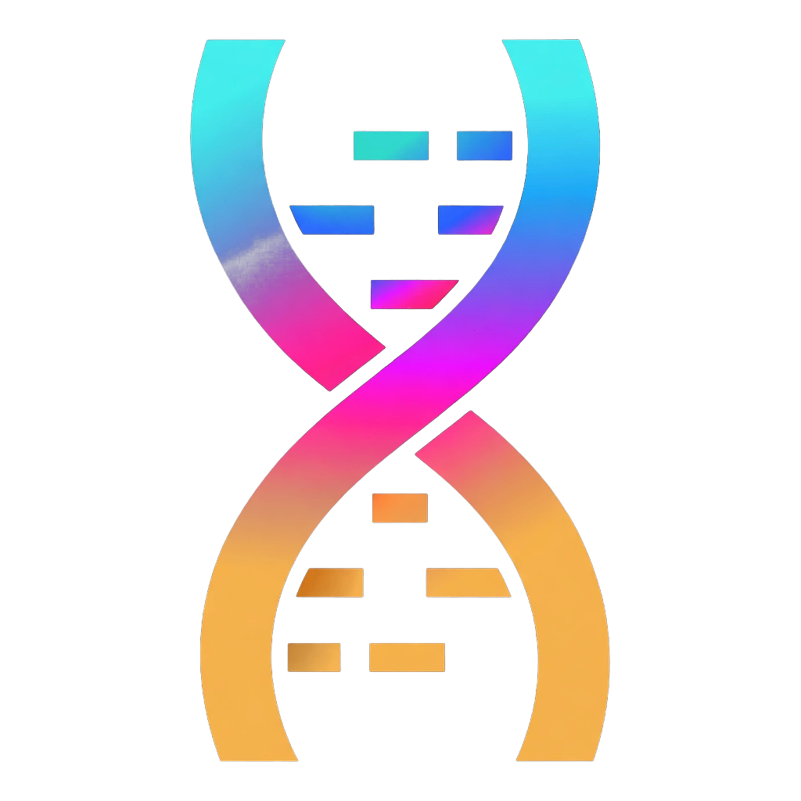

<p align="center">
  
</p>

<h1 align="center">ChromaDNA</h1>

<p align="center">
  <strong>Adobe Lightroom / Camera Raw Color DNA Miner, Mathematical Preset Blender, XMP Compiler, 3D LUT Exporter, Agent Skill, and MCP Server.</strong>
</p>

<p align="center">
  Mine reusable color DNA, blend compatible looks, analyze photos, compile XMP presets, and export 3D LUTs.
</p>

<p align="center">
  <a href="https://github.com/ThanhNguyxnOrg/chromadna/actions/workflows/ci.yml"></a>
  <a href="https://github.com/ThanhNguyxnOrg/chromadna/releases"></a>
  <a href="https://github.com/ThanhNguyxnOrg/chromadna/releases"></a>
  <a href="LICENSE"></a>
  <a href="pyproject.toml"></a>
</p>

<p align="center">
  <a href="https://github.com/ThanhNguyxnOrg/chromadna/stargazers"></a>
  <a href="https://github.com/ThanhNguyxnOrg/chromadna/network/members"></a>
  <a href="https://github.com/ThanhNguyxnOrg/chromadna/issues"></a>
  <a href="https://github.com/ThanhNguyxnOrg/chromadna/pulls"></a>
  <a href="https://github.com/ThanhNguyxnOrg/chromadna/graphs/contributors"></a>
  <a href="https://github.com/ThanhNguyxnOrg/chromadna/commits/main"></a>
</p>

<p align="center">
  
  
  
  
  
</p>

---

ChromaDNA extracts reusable color settings from supported Lightroom / Camera Raw preset sources, blends compatible profiles, estimates photo-specific exposure and white-balance adjustments, renders approximate previews, and exports XMP presets and 3D LUTs.

**Important limitation:** the preview renderer and `.cube` LUT exporter share an approximate RGB transform. They do not reproduce Adobe Camera Raw's proprietary rendering pipeline, camera profiles, local masks, RAW demosaicing/tone mapping, spatial effects, or every slider operation.

## Requirements

- Python 3.10+
- Node.js 22.20+ and npm for the optional multi-agent setup command.
- uv for MCP server execution.
- Git (the public repository can be cloned without a GitHub account).

## Install the Python project

From the repository root:

```bash
python -m pip install -e .
```

This installs the `chromadna` and `chromadna-mcp` commands with dependencies declared in `pyproject.toml`. The built wheel also bundles the default community catalog, so installed CLI/MCP commands can run outside the source checkout.

## Quick start

```bash
# Optional: extract & deduplicate Color DNA from local .xmp, .dng, and .lrtemplate files
chromadna mine ./raw_vault --out data/color_dna_catalog.json

# List available Color DNA IDs
chromadna list

# Inspect a profile's full sliders and tone curves
chromadna inspect emulsion_kodak_portra_400

# Blend two profiles and compile an XMP preset
chromadna blend --mix emulsion_kodak_portra_400:0.7 emulsion_cinestill_400d:0.3 --name "Hybrid Film" --out ./output_xmp/hybrid_film.xmp

# Render a preview and export a LUT from the same blend
chromadna blend --mix emulsion_kodak_portra_400:0.7 emulsion_cinestill_400d:0.3 --name "Hybrid Film" --out ./output_xmp/hybrid_film.xmp --preview-img ./sample.jpg --preview-out ./output_xmp/preview.jpg --lut ./output_lut/hybrid_film.cube

# Match a profile to a photo
chromadna match ./sample.jpg --dna emulsion_kodak_portra_400 --name "Matched Film" --preview ./output_xmp/matched_preview.jpg --out ./output_xmp/matched.xmp

# Export a standalone 33-cubed LUT
chromadna lut --dna emulsion_kodak_portra_400 --name "Warm Film" --size 33 --out ./output_lut/warm_film.cube
```

If the package is not installed, use the repository launcher:

```bash
bash scripts/chromadna.sh list
```

PowerShell:

```powershell
.\scripts\chromadna.ps1 list
```

## Multi-agent setup

ChromaDNA is distributed from GitHub. It is not currently published to PyPI or npm. Clone the repository, then run:

```bash
node scripts/setup.mjs --all
```

Common flags:

```bash
node scripts/setup.mjs --dry-run
node scripts/setup.mjs --skills --agent=claude-code
node scripts/setup.mjs --mcp --agent=cursor
```

Prefer an AI to perform setup? Copy the single prompt in [Install ChromaDNA with an AI Agent](docs/INSTALL_WITH_AI.md) into any coding agent with terminal access. See [Agent and Client Compatibility](docs/COMPATIBILITY.md) for the full matrix, DeepSeek Harness and Groq API adapters, and cloud-client limitations.

## Community preset catalog

ChromaDNA includes 451 imported creative commons presets in `data/color_dna_catalog.json`. See [Community Catalog Provenance](docs/COMMUNITY_CATALOG.md) for upstream source details, pinned revision, hashes, and license notices.

The catalog is **not refreshed automatically**. Maintainers can review and run the manual workflow in `.github/workflows/community-presets.yml` when they choose to update from upstream.

## Releases

The current release series is **ChromaDNA 1.0.x** (version in `pyproject.toml`). Pushing version updates to `main`—or running **Actions → Release ChromaDNA → Run workflow**—regenerates `uv.lock`, runs tests and wheel smoke checks, creates the matching Git tag, and publishes a GitHub Release with wheel and source archives. It does not publish to PyPI or npm.

## Agent Skill

The canonical Agent Skill is in `skills/chromadna/SKILL.md`. The root `SKILL.md` remains as a compatibility copy for tools that discover a skill from the repository root.

## MCP server

Start the local stdio MCP server:

```bash
chromadna-mcp
```

Available tools:

- `list_color_dna`
- `inspect_color_dna`
- `analyze_photo`
- `blend_color_dna`
- `match_photo_to_dna`
- `render_preview`
- `compile_xmp_preset`
- `export_cube_lut`

The MCP process can only read files accessible to the machine and user account running it. Attaching an image in a cloud chat does not automatically expose its local filesystem path. The current server is not a hosted remote endpoint.

## Privacy and safety

- Keep source photos, RAW files, and third-party preset binaries out of Git.
- Keep `raw_vault/` and generated output files local.
- Do not write generated presets beside RAW files using the same filename stem.
- Do not claim compatibility until the preset or LUT has been tested in the target editor.
- Do not expose the local stdio server to the public internet.
